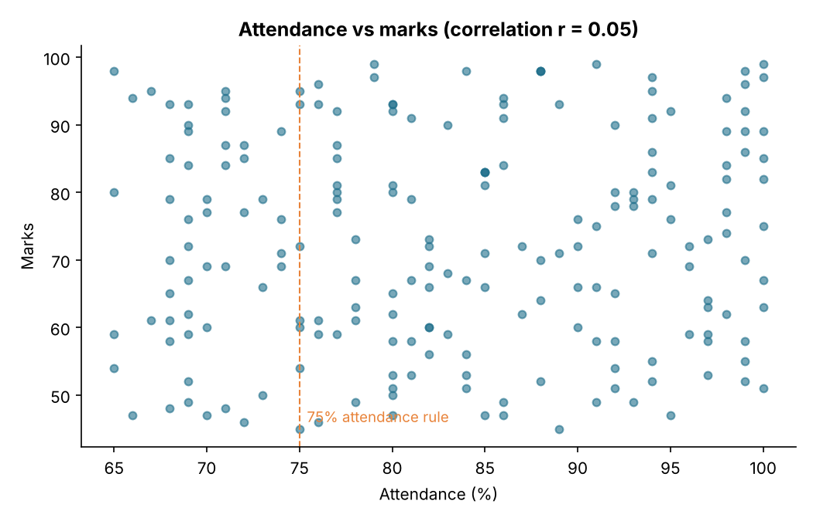
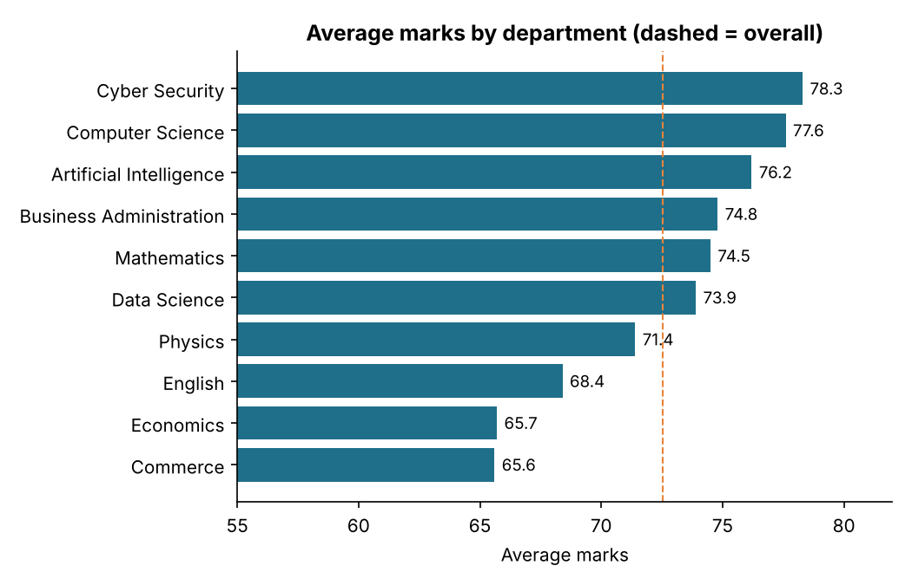
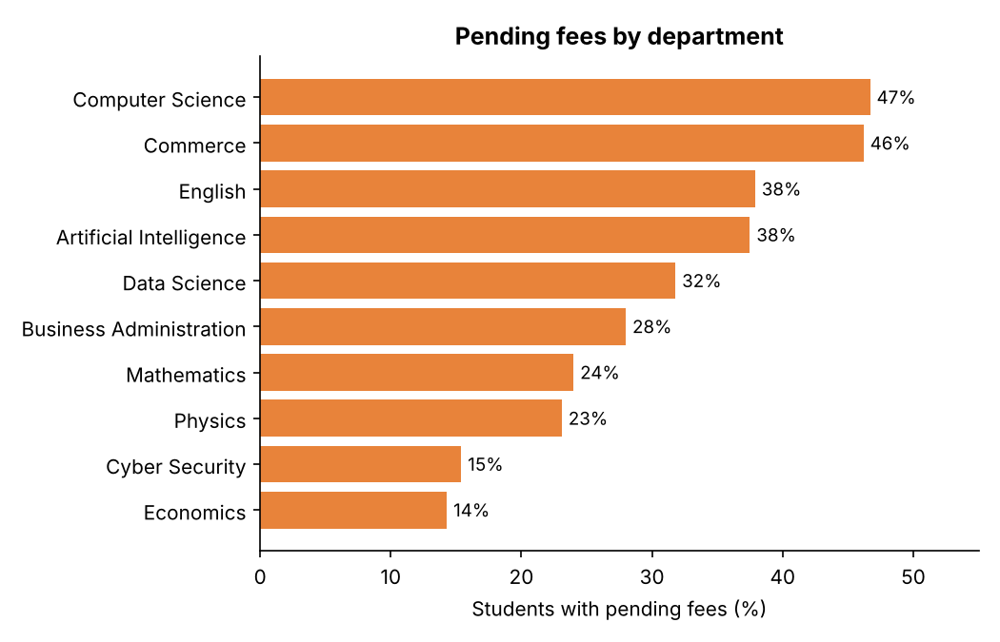

# Insights and Recommendations

Based on `students.csv` (200 students, 10 departments). All figures are reproduced by `insights_analysis.py`.

## Headline numbers
| Metric | Value |
|---|---|
| Students | 200 |
| Average marks | 72.5 |
| Average attendance | 83.2% |
| Pass rate (marks >= 50) | 91.5% (17 failed) |
| Attendance below 75% | 50 students (25%) |
| Pending fees | 61 students (30%) |
| Scholarship eligible (marks >= 75 and attendance >= 75) | 68 students (34%) |

## Findings

### 1. Attendance does not predict marks here
Correlation between attendance and marks is **r = 0.05**, effectively zero. Students under 75% attendance average 72.7 marks versus 72.5 for the rest. Attendance and academic performance should therefore be tracked and supported separately.

### 2. One in four students breaks the 75% attendance rule
50 students are below 75%. Of these, **12 also score under 60 marks**. They are the highest-risk group and the first to contact.

### 3. Commerce and Economics trail on marks
Average marks are 65.6 (Commerce) and 65.7 (Economics), about 7 points below the overall average of 72.5. Cyber Security (78.3) and Computer Science (77.6) lead. Department groups are small (13-29 students), so treat the gaps as signals to investigate, not conclusions.

### 4. Pending fees are concentrated in two departments
30% of students have pending fees. Computer Science (47%) and Commerce (46%) are highest; Economics (14%) and Cyber Security (15%) are lowest. Fee status is unrelated to performance (paid 72.9 vs pending 71.9 average marks).

### 5. A single follow-up list
**16 students have both pending fees and attendance below 75%.** Contacting them once, about both issues, is more efficient than two separate campaigns.

### 6. Scholarships
68 students (34%) meet the criteria of 75+ marks and 75%+ attendance, the rule used in the dashboards. Raising the bar to 90 marks and 85% attendance would shrink the list to 19, which may suit a limited scholarship budget.

## Recommendations
1. Contact the 12 students with low attendance and low marks first.
2. Review teaching support and assessment difficulty in Commerce and Economics.
3. Send fee reminders to Computer Science and Commerce, starting with the 16 low-attendance students.
4. Track attendance and marks as separate indicators; one does not stand in for the other.

## Limitations
The data is a single snapshot (Kaggle dataset, 200 students), so no time trends or causal claims can be drawn, and several department groups are small. A real deployment should use per-term marks and daily attendance, which the `marks` and `attendance` tables are already designed for.
