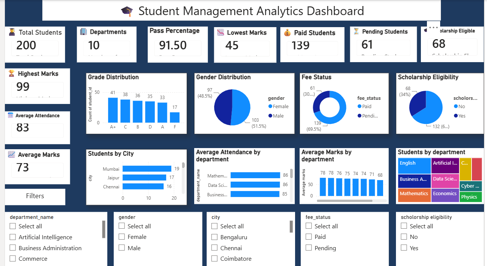
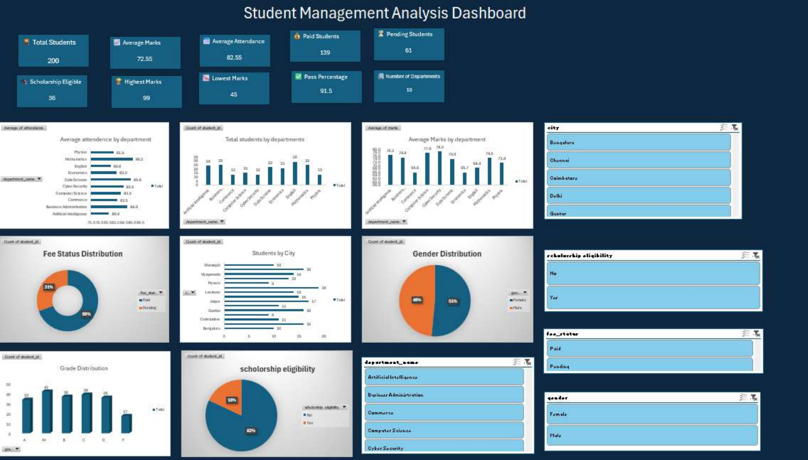

# Student Management Analytics

A student management system built with **PostgreSQL + Python**, with analytics dashboards in **Excel** and **Power BI**.

### Power BI dashboard

### Excel dashboard

## Key findings (200 students, 10 departments)
- **Pass rate 91.5%** (17 students below 50 marks); average marks 72.5, average attendance 83.2%.
- **25% of students (50) are below the 75% attendance rule**, and 12 of them also score under 60 marks, making them the highest-risk group.
- **Attendance does not predict marks in this dataset** (correlation r = 0.05), so attendance and academic support need separate interventions.
- **Commerce (65.6) and Economics (65.7) have the lowest average marks**; Cyber Security (78.3) and Computer Science (77.6) the highest.
- **30% of students (61) have pending fees**, highest in Computer Science (47%) and Commerce (46%). 16 students have both pending fees and low attendance, which makes a ready-made follow-up list.
- **68 students (34%) qualify for a scholarship** (marks >= 75 and attendance >= 75), the same rule used in the Power BI dashboard.

Full write-up: [INSIGHTS.md](INSIGHTS.md). Reproduce the numbers and charts with `python insights_analysis.py`.

> Dataset: sourced from Kaggle. Relationships between variables are weak in this data (for example attendance vs marks, r = 0.05), so findings are descriptive rather than causal.

## What it does
- **Database (PostgreSQL):** departments, students, faculty, courses, attendance, marks and fees tables, plus a `student_report` view, a `get_grade()` function, a delete-audit trigger (`deleted_students`) and indexes.
- **Python CLI scripts:** add / view / search / update / delete students, report cards, grades, toppers, top-3 rankings, scholarship eligibility, attendance and fee analytics, class statistics.
- **Dashboards:** `Excel dashboard.pdf` and `student management analytics dashboard.pbix` (KPIs, department, city, gender, fee-status, grade and scholarship views).

## Setup
1. Install PostgreSQL and Python 3, then `pip install "psycopg[binary]"`.
2. Run the first line of `student management analytics.sql` (`CREATE DATABASE`), connect to `student_management`, then run the rest of the file.
3. Import the CSV files (`departments.csv`, then `students.csv`, etc.) into the matching tables.
4. Set your database password as an environment variable (it is not stored in the code): PowerShell `$env:DB_PASSWORD="your_password"`, or Linux/macOS `export DB_PASSWORD=your_password`. Optional overrides: `DB_HOST`, `DB_NAME`, `DB_USER`, `DB_PORT` (defaults: localhost, student_management, postgres, 5432).
5. Check the connection: `python test-connection.py`.

## Scripts
| Script | Purpose |
|---|---|
| `add student.py` | Add a student (validated input) |
| `view student.py` / `search student.py` / `search by name.py` | Browse and search |
| `update marks.py` | Update a student's marks |
| `delete student.py` | Delete a student (logged by trigger) |
| `report card.py` / `student report.py` / `student_grades.py` | Reports and grades |
| `topper.py` / `top 3 rankings.py` | Toppers |
| `scholarship card.py` | Scholarship list: marks >= 75 and attendance >= 75 |
| `attedance below 75.py` / `attendance_analysis.py` | Attendance analytics |
| `fee analytics.py` / `class statistics.py` / `grade distribution.py` | Class-level analytics |
| `insights_analysis.py` | Pandas analysis that prints the key findings and saves the charts in `screenshots/` |

Grades: A+ (90+), A (80+), B (70+), C (60+), D (50+), F (below 50).

## Dataset
Kaggle student dataset: 200 students across 10 departments (`students.csv`), loaded into PostgreSQL.
